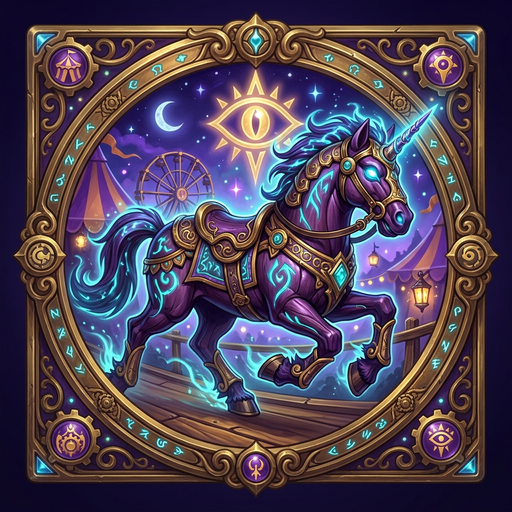

# 🎪 Guildrun — Das Dunkelmond-Derby

<p align="center">
  
</p>

<p align="center">
  <strong>Das ultimative Gilden-Levelrennen für World of Warcraft</strong><br>
  <em>Im stimmungsvollen Jahrmarkt-Stil des Dunkelmond-Pferderennens ("Ball ins Loch rollen")</em>
</p>

<p align="center">
  
  
  
  
  
  
</p>

---

## 🌟 Über Guildrun

**Guildrun** verwandelt das gemeinsame Leveln in deiner Gilde in ein spannendes, animiertes Jahrmarkt-Wettrennen! 

Inspiriert vom legendären Jahrmarkt-Klassiker hat jeder Charakter seine eigene Rennbahn. Mit jedem Levelaufstieg, jedem Meilenstein und jedem Todesfall galoppieren die Renn-Icons weiter nach rechts dem Ziel entgegen.

Das Projekt besteht aus **drei perfekt aufeinander abgestimmten Modulen**:
1. 🎮 **In-Game Addon (`addon/Guildrun`)**: Autonomes WoW-Addon für alle Spieler mit Rennstrecke, Meilenstein-Details und Ruhmeshalle.
2. 🌐 **Live Web-Derby (`web/`)**: Öffentliche oder streamerfreundliche Web-Oberfläche mit Live-Tracking für Monitore (auch im Hochkant-Layout!).
3. ⚡ **PowerShell Live Uploader (`web/GuildrunUploader.ps1`)**: Automatische Synchronisation der Spieldaten ins Web mit ausfallsicherem Meilenstein-Backup.

---

## ✨ Features im Überblick

### 🏇 In-Game Addon
- **Pferderennen-Strecke (Horizontal von links nach rechts):** Jeder Gildenkollege erhält eine eigene animierte Spur mit Reittier- bzw. Klassen-Icon und Levelplakette.
- **Freie Reittierwahl:** Wähle aus über 10 verschiedenen Völkermounts (Nachtelfen-Säbelzahntiger, Untoten-Skelettross, Orc-Wolf, Zwergen-Widder, Gnomen-Schreiter u.v.m.).
- **Dynamische Streckenbegrenzung:** Die Strecke passt sich automatisch dem Führenden an (z. B. bis Level 15 sichtbar, solange niemand Level 10 überschritten hat).
- **10er-Meilenstein-Wimpel:** Bei Level 10, 20, 30, 40, 50 und 60 steht ein Wimpel. Erreichte Meilensteine leuchten golden und zeigen per Mouseover:
  - ⏱️ **Genaue Spielzeit (`/played`)** beim Erreichen
  - 🗺️ **Zone**, in der das Level erreicht wurde
  - 💀 **Todesanzahl**, die bis zum Meilenstein angefallen ist
- **Ruhmeshalle (Hall of Fame):** Ranglisten für *Höchstes Level*, *Speedrunner* (schnellste `/played`-Zeit), *Meiste Tode* (Graveyard-King) und *Top-Chars pro Account*.
- **P2P Addon-Sync:** Tauscht Daten automatisch und unbemerkt über den internen Gildenchat-Channel aus – keine externen Server für normale Spieler nötig!
- **Dunkelmond-Soundkulisse:** Originale Jahrmarkt-Glocken und Jubel-Effekte bei Meilensteinen und Siegen.

### 🌐 Live Web-Derby Dashboard
- **Derby-Atmosphäre:** Gestreifter Baldachin in Dunkelmond-Violett & Gold, Messingverzierungen und flüssige Animationen.
- **Vollständig responsiv:** Automatische Umschaltung zwischen klassischem Breitbild-Modus und **vertikalem Hochkant-Layout** (ideal für Zweitmonitore oder Twitch-Overlays).
- **Live-Statusanzeige:** Erkennt automatisch, ob Server-Livedaten vorliegen oder zeigt ein Demo-Rennen an.

### ⚡ PowerShell Live Uploader & Milestone Guardian
- **Automatischer Hintergrund-Upload:** Erkennt Änderungen in `SavedVariables` und sendet diese sekundenschnell an die Web-API.
- **Automatische Account-Erkennung:** Findet deine WoW-Installationen (Retail, Classic, Forever) und Accounts automatisch.
- **Meilenstein-Schutz (Milestone Guardian):** Speichert erreichte Meilensteine in einem separaten Backup (`milestones_backup.json`), damit historische Bestzeiten selbst nach einem WoW-Crash oder Addon-Reset wiederhergestellt werden können.

---

## 📁 Repository-Struktur

```text
Guildrun/
├── addon/
│   └── Guildrun/                      # In-Game WoW Addon
│       ├── Guildrun.toc               # Universal-Manifest (Interface 16001 / WoW Forever)
│       ├── Guildrun_Mainline.toc      # Retail (11.0.x)
│       ├── Guildrun_Cata.toc          # Cataclysm Classic (4.4.x)
│       ├── Guildrun_Vanilla.toc       # Classic Era & Hardcore (1.15.x)
│       ├── Guildrun_Forever.toc       # WoW Forever Edition
│       ├── Guildrun.lua               # Logik, Events, Synchronisation & DB
│       ├── GuildrunUI.lua             # Dunkelmond-Derby UI & Hall of Fame
│       └── icon.png                   # Offizielles Dunkelmond-Wappen (512x512)
│
├── web/                               # Live Web Derby & Server-Schnittstelle
│   ├── index.html                     # Rennbahn-Webseite (Responsive)
│   ├── css/derby.css                  # Dunkelmond-Styles, Schienen, Responsives Layout
│   ├── js/derby.js                    # Web-Animationslogik & Live-Polling
│   ├── assets/                        # Icons, Favicons & Grafiken
│   ├── api/
│   │   ├── update.php                 # Sichere REST-API Schnittstelle
│   │   ├── config.example.php         # Konfigurationsvorlage für API-Key
│   │   └── config.php                 # (Lokal, in .gitignore)
│   ├── GuildrunUploader.ps1           # PowerShell Live-Uploader & Backup-Wächter
│   ├── GuildrunUploader.bat           # 1-Klick-Starter für Windows
│   ├── RestoreMilestones.ps1          # Wiederherstellungstool für Meilensteine
│   ├── uploader_config.example.json   # Konfigurationsvorlage für Uploader
│   └── uploader_config.json           # (Lokal, in .gitignore)
│
├── CURSEFORGE_RELEASE.md              # Beschreibung & Anleitung für CurseForge
├── icon.png                           # Projekt-Logo
├── LICENSE                            # MIT Lizenz
└── README.md                          # Diese Dokumentation
```

---

## 🚀 Schnellanleitung

### Variante A: Nur das Addon nutzen (für Gildenmitglieder)
1. Lade die aktuelle `Guildrun.zip` aus den [Releases](https://github.com/it-fanatic/Guildrun/releases) herunter.
2. Entpacke den Ordner `Guildrun` in dein WoW-Addon-Verzeichnis:
   - `World of Warcraft\_retail_\Interface\AddOns\` (oder `_classic_`, `_classic_era_`, `_forever_`)
3. Im Spiel eingeben:
   - `/guildrun` oder `/gr` – Öffnet das Dunkelmond-Derby.
   - `/gr mount` – Wähle dein Lieblings-Reittier für die Rennbahn.

---

### Variante B: Das Web-Derby für deine Gilde hosten

#### 1. Webspace einrichten (PHP)
1. Lade den Inhalt des Ordners `web/` auf deinen Webserver oder Webspace hoch.
2. Kopiere im Verzeichnis `api/` die Datei `config.example.php` nach `config.php`:
   ```bash
   cp web/api/config.example.php web/api/config.php
   ```
3. Öffne `config.php` und trage ein sicheres Passwort ein:
   ```php
   $SECRET_KEY = "DEIN_GEHEIMES_ADMIN_PASSWORT";
   ```
4. Stelle sicher, dass der Ordner `api/` Schreibrechte besitzt (für `derby_data.json`).

#### 2. Live Uploader starten (Windows)
1. Kopiere im Ordner `web/` die Datei `uploader_config.example.json` nach `uploader_config.json`.
2. Öffne `uploader_config.json` und passe die Werte an:
   ```json
   {
     "server_url": "https://deine-gildenseite.de/api/update.php",
     "api_key": "DEIN_GEHEIMES_ADMIN_PASSWORT",
     "wow_savedvariables_path": ""
   }
   ```
   *(Tipp: Wenn `wow_savedvariables_path` leer gelassen wird, sucht das Skript automatisch nach deiner Guildrun-Installation!)*
3. Starte den Uploader einfach per Doppelklick auf `GuildrunUploader.bat`.
4. Sobald du im Spiel `/reload` ausführst oder ausloggst, aktualisiert sich die Webseite automatisch in Echtzeit!

---

## ⌨️ In-Game Befehle

| Befehl | Beschreibung |
| :--- | :--- |
| `/gr` oder `/guildrun` | Öffnet oder schließt das Rennfenster |
| `/gr mount` | Öffnet das Auswahlfenster für dein Volksreittier |
| `/gr refresh` | Erzwingt eine Aktualisierung der Daten und synchronisiert mit der Gilde |
| `/gr sound` | Schaltet die Jahrmarkt-Soundeffekte ein oder aus |
| `/gr remove <Name>` | Entfernt einen inaktiven Charakter aus der lokalen Liste |
| `/gr reset` | *(Gildenmeister)* Setzt das gesamte Gildenrennen auf Start zurück |
| `/gr test` | Füllt die Rennstrecke zu Testzwecken mit Beispiel-Charakteren |

---

## 🔒 Sicherheit & Datenschutz

- **Keine Passwörter im Repository:** Weder API-Schlüssel noch Server-URLs oder persönliche Accountpfade sind im Git-Verlauf enthalten.
- **Lokale Konfiguration:** Alle schützenswerten Daten liegen in `config.php` und `uploader_config.json`, welche standardmäßig durch `.gitignore` geschützt sind.
- **Keine Accountnamen-Lecks:** Der Uploader nutzt dynamische Pfaderkennung, sodass keine privaten Accountnamen veröffentlicht werden.

---

## 📜 Lizenz & Danksagung

Dieses Projekt steht unter der [MIT Lizenz](LICENSE).  
Entwickelt mit ❤️ für die WoW-Community von **Kolonieblagen NRW**.
